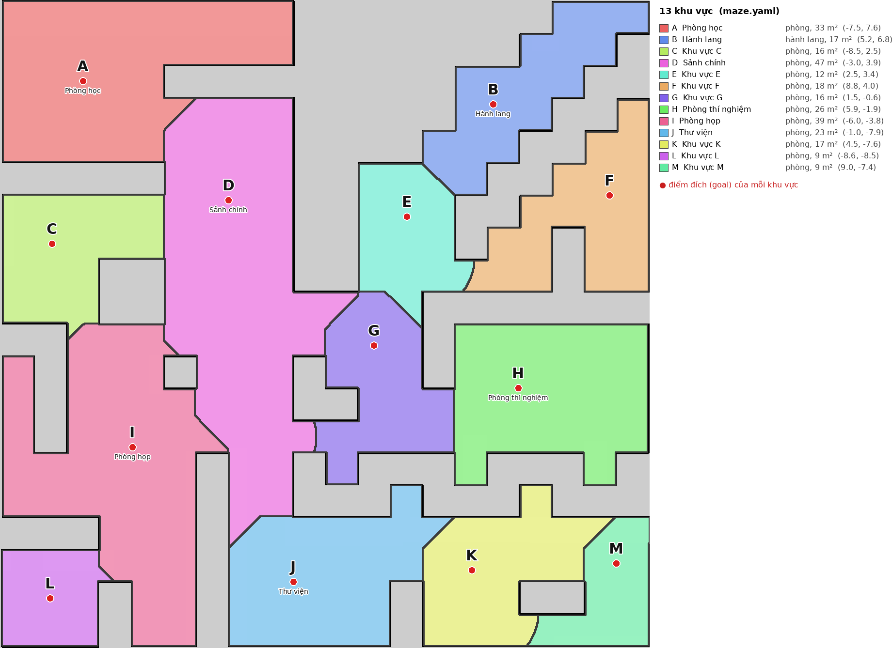

# TurtleBot 4 – Phân vùng bản đồ và điều hướng bằng giọng nói

Bản đồ 2D → chia thành các khu vực có nhãn (A, B, C… / Phòng học, Phòng thí nghiệm, Hành lang…) → nói câu lệnh tiếng Việt → Whisper chuyển thành văn bản → phân tích câu lệnh → Nav2 đưa robot tới khu vực.

```
 micro ──▶ speech_recognizer ──/voice/text──▶ voice_navigator ──NavigateToPose──▶ Nav2 ──▶ TurtleBot 4 (Gazebo)
           (Whisper / Vosk)                   (tìm khu vực, lập lộ trình)
                                                    │ /voice/feedback (phản hồi)
                                                    └ /voice_navigator/active_zone ──▶ zone_publisher ──▶ RViz
```

Mã nguồn, thuật toán và kết quả kiểm thử chi tiết: [src/tb4_voice_nav/README.md](src/tb4_voice_nav/README.md).

---

## 0. Chuẩn bị (làm một lần)

```bash
# Thư viện nhận dạng giọng nói (giữ numpy<2; anyio 3.7.1 để pytest của Ubuntu 22.04 không bị hỏng)
pip3 install --user vosk faster-whisper "numpy<2" "anyio==3.7.1"

# Mô hình Whisper small (~460 MB) và Vosk tiếng Việt (~50 MB)
mkdir -p ~/tb4_ws/models/whisper ~/tb4_ws/models/vosk
python3 -c "from faster_whisper.utils import download_model; \
download_model('small', output_dir='$HOME/tb4_ws/models/whisper/faster-whisper-small')"
cd ~/tb4_ws/models/vosk && wget https://alphacephei.com/vosk/models/vosk-model-small-vn-0.4.zip \
  && unzip vosk-model-small-vn-0.4.zip && rm vosk-model-small-vn-0.4.zip

# Build
cd ~/tb4_ws
colcon build --symlink-install --packages-select tb4_voice_nav
```

> Trên máy này các mô hình đã tải sẵn vào `~/tb4_ws/models/`, thư viện đã cài; chỉ cần build.

**Mọi terminal mới** đều phải source trước khi chạy lệnh ROS:

```bash
source ~/tb4_ws/install/setup.bash
```

Kiểm tra: `ros2 pkg executables tb4_voice_nav` phải in đủ 5 lệnh `segment_map`, `speech_recognizer`, `voice_console`, `voice_navigator`, `zone_publisher`.

---

## 1. Chạy hệ thống (3 terminal)

| Terminal | Việc | Lệnh |
|----------|------|------|
| 1 | Mô phỏng: Gazebo maze + AMCL + Nav2 | `ros2 launch tb4_voice_nav sim.launch.py` |
| 2 | RViz + điều hướng + nghe micro | `ros2 launch tb4_voice_nav voice_nav.launch.py` |
| 3 | (tùy chọn) gõ lệnh thay giọng nói, xem phản hồi | `ros2 run tb4_voice_nav voice_console` |

Nên bật terminal 2 **sau khi** terminal 1 đã in `Managed nodes are active` lần thứ hai (Nav2 lên xong, khoảng 30–40 s); bật cùng lúc dễ làm Nav2 kẹt khởi động. Nếu vẫn kẹt, terminal 2 tự kích hoạt Nav2 sau 45 s (`Tự configure …`, `Tự activate …`).

Đợi terminal 2 in:

```
Sẵn sàng nhận lệnh giọng nói, robot đang ở D (Sảnh chính). Ví dụ: "Đi đến khu vực A"
```

(khoảng 40 s sau khi bật terminal 1; node tự đặt initial pose cho AMCL, robot tự undock khi nhận lệnh di chuyển đầu tiên) rồi nói vào micro laptop.

Biến thể hay dùng:

```bash
ros2 launch tb4_voice_nav sim.launch.py gui:=false              # không mở cửa sổ Gazebo (máy yếu)
ros2 launch tb4_voice_nav voice_nav.launch.py speech:=false     # không dùng micro, chỉ gõ lệnh ở terminal 3
ros2 launch tb4_voice_nav voice_nav.launch.py engine:=vosk      # Vosk thay Whisper (nhẹ hơn, kém chính xác hơn)
```

Phòng ồn (nhiều người nói chuyện): chạy nhận dạng giọng nói riêng ở chế độ nhấn Enter rồi nói:

```bash
ros2 launch tb4_voice_nav voice_nav.launch.py speech:=false                     # terminal 2
ros2 run tb4_voice_nav speech_recognizer --ros-args -p push_to_talk:=true      # terminal 3: Enter rồi nói trong 6 s
```

---

## 2. Các câu lệnh giọng nói

| Câu nói | Robot làm gì |
|---------|--------------|
| "Đi đến khu vực A." | Tới khu vực A |
| "Di chuyển từ khu vực A đến khu vực B." | Robot không ở A → đi qua A rồi tới B; đang ở A → đi thẳng tới B |
| "Đi đến phòng thí nghiệm." | Tới khu vực H (Phòng thí nghiệm) |
| "Đi đến hành lang." / "Đi đến thư viện." / "Về sảnh chính." | Tới khu vực theo tên |
| "Đi đến khu vực A rồi đến khu vực D." | Đi lần lượt A rồi D |
| "Đi đến khu vực Z." / "Đi đến nhà bếp." | Báo **khu vực không tồn tại**, liệt kê khu vực hợp lệ, robot không di chuyển |
| "Dừng lại." | Hủy goal, robot dừng |
| "Robot đang ở đâu?" | Báo tọa độ và khu vực hiện tại |
| "Có những khu vực nào?" | Liệt kê khu vực |

Nói lệnh mới khi robot đang chạy → hủy lộ trình cũ, chạy lệnh mới.

Các khu vực trên bản đồ maze:

| id | tên | id | tên |
|----|-----|----|-----|
| A | Phòng học | H | Phòng thí nghiệm |
| B | Hành lang | I | Phòng họp |
| C | Khu vực C | J | Thư viện |
| D | Sảnh chính (robot xuất phát ở đây) | K | Khu vực K |
| E | Khu vực E | L | Khu vực L |
| F | Khu vực F | M | Khu vực M |
| G | Khu vực G | | |



---

## 3. Kịch bản demo (kiểm từng yêu cầu)

Sau khi terminal 2 báo sẵn sàng, nói lần lượt (đợi robot tới nơi mới nói câu tiếp):

1. **"Đi đến khu vực Z."** → terminal 2 in `Không có khu vực "khu vuc z" trên bản đồ, robot không di chuyển. Các khu vực hiện có: ...` (yêu cầu: khu vực không tồn tại).
2. **"Di chuyển từ khu vực A đến khu vực B."** → `Lộ trình: A (Phòng học) -> B (Hành lang). Robot đang ở D (Sảnh chính) -> đi qua A (Phòng học) trước.`, rồi `Đã đến A ...`, `Đã đến B ...` (yêu cầu: đi qua A trước khi đến B).
3. **"Đi đến phòng thí nghiệm."** → `Đã đến H (Phòng thí nghiệm) sau ... s, ... đúng khu vực H; va chạm 0, gần vật cản nhất ... m` (yêu cầu: đến đúng khu vực, tránh vật cản).
4. **"Đi đến thư viện."**, vài giây sau **"Dừng lại."** → `Đã dừng, hủy lộ trình`, robot đứng yên.
5. **"Robot đang ở đâu?"** → `Robot ở (x, y), trong ...`.

Trên RViz: mỗi khu vực một màu, nhãn `A - Phong hoc`… và trụ đỏ ở điểm đích; khu vực robot đang tới chuyển **vàng**; đường đi Nav2 vẽ trên bản đồ.

Xem phản hồi bằng chữ ở terminal khác: `ros2 topic echo /voice/feedback`. Xem văn bản nhận dạng: `ros2 topic echo /voice/text`.

---

## 4. Phân vùng bản đồ (tùy chọn – kết quả đã có sẵn)

```bash
ros2 run tb4_voice_nav segment_map              # chạy lại phân vùng -> config/zones.yaml + ảnh preview
ros2 run tb4_voice_nav segment_map --show       # mở cửa sổ xem kết quả
ros2 run tb4_voice_nav segment_map --core-dist 0.9 --min-area 8    # chỉnh độ chi tiết
```

- Đặt tên / bí danh / vẽ tay khu vực: sửa `src/tb4_voice_nav/config/zone_names.yaml` rồi chạy lại `segment_map`.
- Dùng bản đồ khác: `segment_map --map <map.yaml> --names ""` và chạy sim với **cùng** bản đồ: `sim.launch.py map:=<map.yaml>`.

---

## 5. Kiểm thử tự động

```bash
cd ~/tb4_ws
colcon test --packages-select tb4_voice_nav && colcon test-result --test-result-base build/tb4_voice_nav
```

Kết quả mong đợi: `47 tests, 0 errors, 0 failures` (phân tích câu lệnh, phân vùng, VAD).

Thử riêng bộ nhận dạng giọng nói (nói 1 câu, xem văn bản in ra):

```bash
ros2 run tb4_voice_nav speech_recognizer --ros-args -p show_level:=true
```

---

## 6. Dừng và dọn dẹp

`Ctrl+C` ở terminal 2 trước (node hủy goal đang chạy, robot dừng), rồi terminal 1. Nếu còn tiến trình Gazebo:

```bash
pkill -f "ign gazebo"
```

---

## 7. Xử lý sự cố

| Hiện tượng | Cách xử lý |
|---|---|
| Robot nghe lệnh nhưng trả lời `Nav2 chưa sẵn sàng; đã ghi nhận lệnh…` | Bình thường khi Nav2 đang khởi động: lệnh được giữ lại và tự chạy khi Nav2 sẵn sàng. Nên bật terminal 2 **sau** khi terminal 1 đã in `Managed nodes are active` (bật cùng lúc dễ làm Nav2 kẹt) |
| Terminal 2 in `Chờ Nav2 (bt_navigator: unconfigured …)` lâu, log Nav2 có `failed to send response to /controller_server/change_state` | Lifecycle manager của Nav2 bị kẹt (lỗi DDS của ROS 2 Humble). Sau 45 s `voice_navigator` tự configure / activate các node Nav2 (`Tự configure …`, `Tự activate …`) rồi chạy lệnh đang chờ; không cần làm gì |
| Log `CRITICAL FAILURE: SERVER ... IS DOWN after not receiving a heartbeat` | Máy quá tải CPU: dùng `gui:=false` hoặc `engine:=vosk` |
| Nói mà không có `... đang nghe câu lệnh` | Kiểm tra micro mặc định `pactl get-default-source`; chạy `speech_recognizer` với `show_level:=true` và giảm `vad_ratio` (ví dụ `-p vad_ratio:=3.0`) |
| Nhận cả tiếng nói chuyện xung quanh | Dùng chế độ `push_to_talk:=true` (mục 1) |
| Tên khu vực đúng mà robot báo không tồn tại | Thêm cách gọi vào `aliases` trong `zone_names.yaml`, chạy lại `segment_map` |
| LiDAR toàn `range_min`, robot không đi | Gazebo chạy trên GPU Intel: giữ mặc định `nvidia:=true` |
| `pytest` báo `No module named '_pytest.scope'` | `pip3 install --user "anyio==3.7.1"` |
