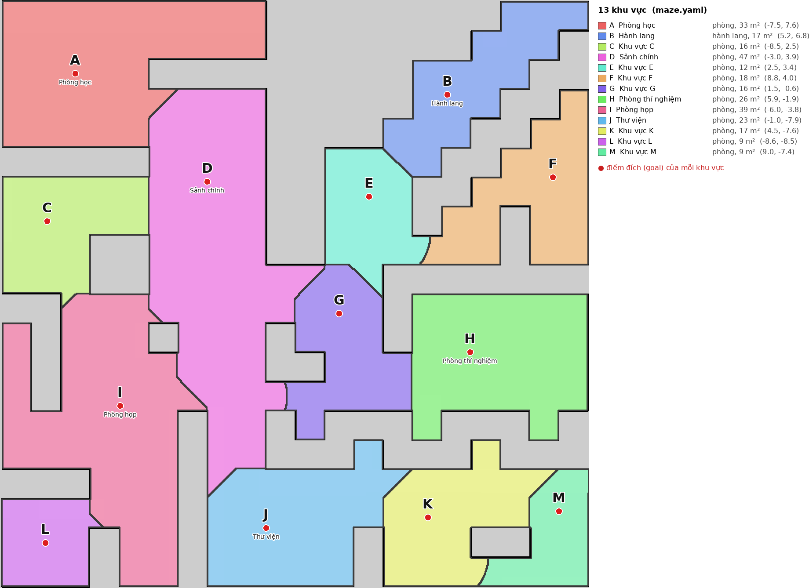

# TurtleBot 4 – Phân vùng bản đồ và điều hướng bằng giọng nói

Bản đồ Occupancy Grid → phân vùng tự động (OpenCV) → gắn nhãn khu vực (A, B, C… / Phòng học, Phòng thí nghiệm…) → nói câu lệnh tiếng Việt → Whisper/Vosk → phân tích câu lệnh → Nav2 `NavigateToPose`.

```
 map.yaml + .pgm ──segment_map──▶ config/zones.yaml + zones_labels.png + zones_preview.png
                                         │
 micro ──arecord──▶ speech_recognizer ──/voice/text──▶ voice_navigator ──NavigateToPose──▶ Nav2 ──▶ TurtleBot 4
            (VAD + Whisper / Vosk)          ▲            (parser + lộ trình)      │
 bàn phím ──voice_console───────────────────┘            /voice/feedback ◀────────┘
                                                         /voice_navigator/active_zone ──▶ zone_publisher ──▶ RViz
```



Mục lục:
- [0. Cài đặt (làm một lần)](#0-cài-đặt-làm-một-lần)
- [Tóm tắt lệnh](#tóm-tắt-lệnh)
- [1. Phân vùng bản đồ và gắn nhãn](#1-phân-vùng-bản-đồ-và-gắn-nhãn)
- [2. Nhận dạng giọng nói](#2-nhận-dạng-giọng-nói)
- [3. Điều hướng bằng giọng nói](#3-điều-hướng-bằng-giọng-nói)
- [Thuật toán](#thuật-toán)
- [Kết quả kiểm thử](#kết-quả-kiểm-thử)
- [Tham số](#tham-số)
- [Xử lý sự cố](#xử-lý-sự-cố)

---

## 0. Cài đặt (làm một lần)

```bash
# Nhận dạng giọng nói. Giữ numpy<2 (cv_bridge, ultralytics). anyio 3.7.1: bản 4.x (kéo theo faster-whisper)
# có plugin pytest không chạy với pytest 6 của Ubuntu 22.04 -> làm hỏng colcon test của mọi package.
pip3 install --user vosk faster-whisper "numpy<2" "anyio==3.7.1"

# Mô hình Whisper small (~460 MB) và Vosk tiếng Việt (~50 MB) vào ~/tb4_ws/models
mkdir -p ~/tb4_ws/models/whisper ~/tb4_ws/models/vosk
python3 -c "from faster_whisper.utils import download_model; \
download_model('small', output_dir='$HOME/tb4_ws/models/whisper/faster-whisper-small')"
cd ~/tb4_ws/models/vosk && wget https://alphacephei.com/vosk/models/vosk-model-small-vn-0.4.zip \
  && unzip vosk-model-small-vn-0.4.zip && rm vosk-model-small-vn-0.4.zip

# Build
cd ~/tb4_ws
colcon build --symlink-install --packages-select tb4_voice_nav
source ~/tb4_ws/install/setup.bash
```

Kiểm tra: `ros2 pkg executables tb4_voice_nav` phải có đủ 5 lệnh: `segment_map`, `speech_recognizer`, `voice_console`, `voice_navigator`, `zone_publisher`.

Thu âm dùng `arecord` (gói `alsa-utils`, có sẵn trên Ubuntu) qua PulseAudio, không cần PortAudio.

---

## Tóm tắt lệnh

Mỗi dòng một terminal, nhớ `source ~/tb4_ws/install/setup.bash`.

| # | Việc | Lệnh |
|---|------|------|
| 1 | (tùy chọn) phân vùng lại bản đồ | `ros2 run tb4_voice_nav segment_map` |
| 2 | Mô phỏng: Gazebo maze + AMCL + Nav2 | `ros2 launch tb4_voice_nav sim.launch.py` |
| 3 | Khu vực trên RViz + điều hướng + micro | `ros2 launch tb4_voice_nav voice_nav.launch.py` |
| 4 | (tùy chọn) gõ lệnh thay giọng nói | `ros2 run tb4_voice_nav voice_console` |

Đợi terminal 3 in `Sẵn sàng nhận lệnh giọng nói, robot đang ở D (Sảnh chính)` (~40 s sau khi bật sim) rồi nói vào micro:

- "Đi đến khu vực A."
- "Di chuyển từ khu vực A đến khu vực B."
- "Đi đến phòng thí nghiệm."
- "Dừng lại." · "Robot đang ở đâu?" · "Có những khu vực nào?"

---

## 1. Phân vùng bản đồ và gắn nhãn

```bash
ros2 run tb4_voice_nav segment_map            # bản đồ maps/maze.yaml + config/zone_names.yaml -> config/zones.yaml
ros2 run tb4_voice_nav segment_map --show     # mở cửa sổ xem ảnh kết quả
ros2 run tb4_voice_nav segment_map --map ~/tb4_ws/maps/map.yaml --names "" --out /tmp/zones.yaml
```

Kết quả với bản đồ maze (13 khu vực, 6 khu vực có tên):

| id | tên | loại | m² | điểm đích (x, y) | cách tường |
|----|-----|------|----|------------------|-----------|
| A | Phòng học | phòng | 33.2 | (-7.54, 7.57) | 2.49 m |
| B | Hành lang | hành lang | 17.1 | (5.16, 6.84) | 1.16 m |
| C | Khu vực C | phòng | 15.9 | (-8.49, 2.52) | 1.53 m |
| D | Sảnh chính | phòng | 47.2 | (-3.04, 3.88) | 2.01 m |
| E | Khu vực E | phòng | 12.4 | (2.48, 3.37) | 1.50 m |
| F | Khu vực F | phòng | 18.1 | (8.76, 4.03) | 1.23 m |
| G | Khu vực G | phòng | 15.7 | (1.47, -0.62) | 1.42 m |
| H | Phòng thí nghiệm | phòng | 25.7 | (5.93, -1.95) | 1.98 m |
| I | Phòng họp | phòng | 38.8 | (-6.00, -3.77) | 2.01 m |
| J | Thư viện | phòng | 22.9 | (-1.02, -7.95) | 2.01 m |
| K | Khu vực K | phòng | 17.2 | (4.50, -7.58) | 1.55 m |
| L | Khu vực L | phòng | 9.0 | (-8.55, -8.46) | 1.50 m |
| M | Khu vực M | phòng | 9.0 | (8.96, -7.38) | 1.02 m |

File đầu ra (trong `config/`, với `--symlink-install` ghi thẳng vào `src`):

- `zones.yaml`: mỗi khu vực có `id`, `name`, `aliases`, `kind`, `area`, `goal: [x, y, yaw]` (điểm đích hợp lệ), `center`, `polygon` (biên) – tất cả trong **frame map** (mét), đã đổi từ pixel bằng `resolution` và `origin` của `map.yaml`.
- `zones_labels.png`: ảnh nhãn 16 bit (giá trị pixel = `label` của khu vực), dùng để tra "robot đang ở khu vực nào".
- `zones_preview.png`: ảnh trực quan (hình trên).

**Đặt tên / vẽ tay** trong [config/zone_names.yaml](config/zone_names.yaml): mỗi mục chọn vùng tự động chứa `point: [x, y]`, hoặc vẽ tay biên bằng `polygon: [[x, y], ...]` (đè lên vùng tự động; `--manual-only` để chỉ dùng vùng vẽ tay). Có thể đặt `id`, `aliases`, `kind`, `goal`. Sửa xong chạy lại `segment_map`. Tọa độ lấy bằng công cụ **Publish Point** trên RViz (topic `/clicked_point`).

**Vì sao dùng bản đồ maze của turtlebot4_navigation** (đã copy vào `maps/maze.yaml`) thay vì `~/tb4_ws/maps/map.yaml`: bản đồ tự quét chưa có tường khu tây nam (AMCL lệch tới ~8 m khi robot vào đó), các mép giáp vùng chưa biết nên chỉ tách được 3 vùng. Bản đồ maze đầy đủ khớp world Gazebo (AMCL lệch 3.7 cm lúc khởi động). Muốn dùng bản đồ của mình: chạy `segment_map --map ...` rồi `sim.launch.py map:=...` với **cùng** bản đồ đó.

---

## 2. Nhận dạng giọng nói

```bash
ros2 run tb4_voice_nav speech_recognizer                                  # micro, Whisper
ros2 run tb4_voice_nav speech_recognizer --ros-args -p engine:=vosk       # Vosk (nhẹ hơn, kém chính xác hơn)
ros2 run tb4_voice_nav speech_recognizer --ros-args -p push_to_talk:=true # phòng ồn: Enter rồi nói
ros2 run tb4_voice_nav speech_recognizer --ros-args -p show_level:=true   # in mức âm thanh để chỉnh VAD
ros2 run tb4_voice_nav speech_recognizer --ros-args -p input:=/thư_mục/wav  # nhận dạng từ file WAV 16 kHz mono
ros2 topic echo /voice/text
```

Mỗi câu nhận dạng in ra như: `[mic, 3.8 s âm thanh, nhận dạng 1.51 s] "Di chuyển từ khu vực A đến khu vực B."` và publish lên `/voice/text`.

| Bộ nhận dạng | Ưu | Nhược |
|---|---|---|
| **Whisper small** (mặc định, faster-whisper, CPU int8) | Văn bản có dấu, đúng 9/9 câu thử, ~1.5 s/câu | Mô hình 460 MB, tốn CPU |
| Vosk small vn + ngữ pháp | Rất nhanh (0.1 s), 50 MB | Đúng ~5/9 câu thử: "A" → "ca", "phòng học" → "phòng họp" |

GPU: ctranslate2 4.x cần thư viện CUDA 12; máy này có CUDA 13 (đi kèm torch) nên `whisper_device: cuda` tự lùi về CPU.

---

## 3. Điều hướng bằng giọng nói

```bash
ros2 launch tb4_voice_nav sim.launch.py                 # Gazebo + AMCL (sau 15 s) + Nav2 (sau 25 s)
ros2 launch tb4_voice_nav sim.launch.py gui:=false      # không mở cửa sổ Gazebo (máy yếu)
ros2 launch tb4_voice_nav voice_nav.launch.py           # zone_publisher + voice_navigator + speech_recognizer + RViz
ros2 launch tb4_voice_nav voice_nav.launch.py speech:=false   # chỉ gõ lệnh bằng voice_console
ros2 run tb4_voice_nav voice_console                    # gõ: Đi đến khu vực A
ros2 run tb4_voice_nav voice_console "Đi đến thư viện"  # gửi 1 câu rồi thoát
ros2 topic echo /voice/feedback                         # phản hồi của robot
```

Trên RViz (`rviz/voice_nav.rviz`): lớp **Zones** tô mỗi khu vực một màu (`/zones/grid`, color scheme costmap), **Zone labels** vẽ biên, nhãn `A - Phong hoc` (RViz không có phông tiếng Việt nên nhãn bỏ dấu) và trụ đỏ ở điểm đích; khu vực robot đang tới chuyển **vàng**. Kèm bản đồ, LiDAR, particle AMCL, costmap, đường đi Nav2.

| Câu nói | Robot |
|---|---|
| Đi đến / tới / về / vào `<khu vực>` | Tới điểm đích của khu vực |
| Di chuyển từ `X` đến `Y` | Robot **không** ở X → đi qua X rồi tới Y; đang ở X → đi thẳng Y |
| Đi đến `X` rồi đến `Y` (sau đó `Z` …) | Đi lần lượt |
| `<khu vực>` = "khu vực A", "khu vực bê", "phòng thí nghiệm", "phòng lab", "thư viện" … | Chữ cái, cách đọc chữ cái, tên, bí danh, sai chính tả nhẹ |
| Khu vực không tồn tại ("khu vực Z", "nhà bếp") | Báo `Không có khu vực "khu vuc z"…`, liệt kê khu vực hợp lệ, **không di chuyển**, nhiệm vụ đang chạy vẫn tiếp tục |
| Dừng lại / hủy / stop | Hủy goal, xóa lộ trình |
| Robot đang ở đâu? · Có những khu vực nào? | Trả lời trên `/voice/feedback` |
| Lệnh mới khi đang chạy | Hủy lộ trình cũ, chạy lộ trình mới |

---

## Thuật toán

### Cấu trúc package

```
tb4_voice_nav/
├── tb4_voice_nav/
│   ├── segmentation.py      # phân vùng (OpenCV/numpy, không ROS)
│   ├── segment_map.py       # CLI: phân vùng + gắn nhãn -> zones.yaml / ảnh
│   ├── zones.py             # đọc zones.yaml, tra khu vực theo tọa độ (không ROS)
│   ├── command_parser.py    # phân tích câu lệnh tiếng Việt (không ROS)
│   ├── audio.py             # arecord, đọc WAV, VAD năng lượng (không ROS)
│   ├── speech_recognizer.py # node: micro/WAV -> Whisper/Vosk -> /voice/text
│   ├── voice_navigator.py   # node: /voice/text -> lộ trình -> Nav2
│   ├── zone_publisher.py    # node: khu vực -> RViz
│   └── voice_console.py     # gõ lệnh bằng bàn phím
├── config/ zone_names.yaml, zones.yaml, zones_labels.png, zones_preview.png, voice_nav.yaml
├── maps/ maze.yaml, maze.pgm
├── launch/ sim.launch.py, voice_nav.launch.py
├── rviz/ voice_nav.rviz
└── test/ test_command_parser.py, test_segmentation.py, test_vad.py   (47 test)
```

### Phân vùng bản đồ (`segmentation.py`)

Ý tưởng: **phòng là chỗ rộng, cửa và hành lang là chỗ hẹp**.

1. **Ngưỡng hóa**: pixel → xác suất chiếm chỗ `p = (255 − px)/255`; ô trống nếu `p < free_thresh` (ô chưa biết = 205 luôn loại). Mở hình thái 3×3 bỏ nhiễu, giữ thành phần trống lớn nhất (vùng robot đi được).
2. **Distance transform** `d(p)`: khoảng cách (m) từ mỗi ô trống tới ô không trống gần nhất.
3. **Hạt giống phòng**: thành phần liên thông của `{d > core_dist}` (`core_dist` = 1.0 m). Cửa/hành lang hẹp hơn 2 m bị cắt đứt → mỗi phòng một hạt giống.
4. **Hạt giống hành lang**: phần trống nằm ngoài *phép mở* của các phòng (dilate hạt giống bằng đĩa bán kính `core_dist`) và cách phòng thêm `door_margin`; thành phần ≥ 1 m² là một hành lang.
5. **Watershed (priority flood) trên d**: duyệt ô trống theo `d` giảm dần bằng hàng đợi ưu tiên, ô nhận nhãn của ô láng giềng đã gán trước nó. Hai vùng gặp nhau ở chỗ `d` nhỏ nhất giữa chúng = **chỗ thắt (cửa)**. (Đã thử `cv2.watershed`: nhãn chảy dọc chân tường thành dải mỏng vì mọi ô sát tường có `d ≈ 0`.)
6. **Gộp vùng nhỏ** (< 6 m²) vào láng giềng có biên chung dài nhất.
7. **Mỗi vùng**: điểm đích = tâm đường tròn nội tiếp lớn nhất (max distance transform của riêng vùng) → xa tường và xa ranh giới nhất, kiểm tra cách tường ≥ 0.45 m (bán kính robot 0.175 m + inflation); biên = `findContours` + `approxPolyDP`; loại *hành lang* nếu bề rộng < 2.4 m và diện tích / bề rộng² > 3.
8. **Gắn nhãn**: mục trong `zone_names.yaml` chọn vùng chứa `point` (hoặc vẽ `polygon`); vùng còn lại nhận chữ cái theo thứ tự đọc (dải 4 m từ trên xuống, trái sang phải).
9. **Pixel → mét**: `x = origin_x + (col + 0.5)·res`, `y = origin_y + (H − row − 0.5)·res`.

### Nhận dạng giọng nói (`speech_recognizer.py`, `audio.py`)

1. `arecord` 16 kHz mono → khung 30 ms.
2. **VAD năng lượng thích nghi**: ồn nền = phân vị 20 % mức dB của 3 s gần nhất (tiếng nói ngắt quãng không kéo ngưỡng lên; ồn tăng thật thì theo kịp); câu bắt đầu khi 3 khung liên tiếp > ồn nền + 14 dB (`vad_ratio` 5), lấy thêm 0.3 s trước đó; kết thúc khi im 0.8 s (tối đa 8 s).
3. **Whisper** (`language=vi`, `beam_size=5`, `initial_prompt` chứa tên các khu vực để tăng độ chính xác tên riêng, Silero VAD bên trong lọc đoạn không có lời); bỏ kết quả "ảo giác" quen thuộc của Whisper tiếng Việt ("hãy subscribe cho kênh…").
   **Vosk**: ngữ pháp ràng buộc = tập câu sinh từ động từ × (chữ cái A–Z đọc tiếng Việt | tên khu vực), lọc theo từ vựng thật của mô hình.
4. **Lọc câu lệnh**: chỉ publish câu có từ chỉ di chuyển / dừng / khu vực (phòng có người nói chuyện thì lời nói khác bị bỏ qua).
5. Tiến trình chạy `nice 10` và 4 luồng CPU để không làm Gazebo/Nav2 lỡ heartbeat.

### Phân tích câu lệnh (`command_parser.py`)

1. Chuẩn hóa (chữ thường, bỏ dấu câu) + bản **bỏ dấu** (`đ → d`) để chịu lỗi dấu của bộ nhận dạng.
2. Bỏ lời mở đầu ("robot ơi", "hãy", "làm ơn"…) và từ đệm cuối ("nhé", "giúp tôi"…).
3. Ý định theo regex: `từ X (đến|tới|sang|qua|về) Y` → [X, Y]; `(đến|tới|về|sang|vào|qua) Y` → [Y]; tách nhiều chặng bằng "rồi / sau đó / tiếp theo"; `dừng|hủy|stop`; `ở đâu`; `những khu vực nào`.
4. Tra khu vực: (a) `khu vực|vùng|khu|phòng <chữ cái>` – chữ cái hoặc cách đọc (a, bê, xê, đê, e, ép, giê, hát, i, ca, e-lờ, em-mờ…); chữ cái không có trên bản đồ → **không tồn tại** (không đoán gần đúng); (b) tên / bí danh khớp nguyên cụm từ, ưu tiên tên dài nhất; nhiều khu vực cùng khớp → hỏi lại; (c) so khớp mờ `difflib` ≥ 0.8 chỉ với tên có ý nghĩa ("phòng thí nghiệp" → Phòng thí nghiệm).

### Điều hướng (`voice_navigator.py`)

```
khởi động (timer, không bao giờ bỏ cuộc): chờ AMCL active -> AMCL chưa có pose thì gửi /initialpose LẶP
           tới khi /amcl_pose xác nhận (bản tin đầu ngay sau khi khớp DDS hay bị mất) -> chờ đủ 7 node Nav2 active
           (thiếu velocity_smoother thì lệnh vận tốc không tới /cmd_vel); lifecycle manager kẹt > 45 s -> tự
           configure/activate; lệnh nói trước đó được giữ lại và chạy khi sẵn sàng; Nav2 mất active -> chờ lại
lệnh GOTO: vị trí robot = TF map->base_link -> tra zones_labels.png -> khu vực hiện tại
           "từ X đến Y": robot ở X -> [Y], không -> [X, Y]
           đang chạy lộ trình cũ -> hủy goal cũ, CHỜ Nav2 trả kết quả goal cũ rồi mới gửi goal mới
           (gửi ngay thì bt_navigator đang dừng goal cũ sẽ abort luôn goal mới)
mỗi khu vực: robot ở dock -> /undock trước
           NavigateToPose(goal của khu vực, hướng = hướng di chuyển) - bất đồng bộ, vẫn nghe lệnh mới
           SUCCEEDED -> kiểm tra robot thật sự nằm trong khu vực -> khu vực kế tiếp
           ABORTED   -> xóa costmap, thử lại 1 lần; quá 240 s -> hủy
giám sát:  đếm va chạm bumper/stall (Create 3), khoảng cách LiDAR nhỏ nhất mỗi chặng
```

Tránh vật cản do Nav2 đảm nhiệm (global costmap từ bản đồ + LiDAR, local costmap + controller); node chỉ chọn đích và theo dõi.

---

## Kết quả kiểm thử

Mô phỏng headless (Gazebo Fortress, world maze, RTF ~0.8), giọng nói tổng hợp (gTTS tiếng Việt) phát vào **micro ảo PulseAudio** → `arecord` → VAD → Whisper → `voice_navigator` → Nav2, tức đi qua đúng đường micro thật.

| # | Câu nói | Whisper nghe | Kết quả |
|---|---------|--------------|---------|
| 1 | Đi đến khu vực Z | "Đi đến khu vực Z." | Báo không tồn tại, liệt kê 13 khu vực, robot đứng yên |
| 2 | Đi đến nhà bếp | "Đi đến nhà bếp." | Báo không tồn tại, robot đứng yên |
| 3 | Di chuyển từ khu vực A đến khu vực B (robot ở D, đang sạc) | đúng | Undock → **qua A** (59 s, cách đích 0.24 m) → **B** (117 s, 0.22 m) |
| 4 | Đi đến phòng thí nghiệm | đúng | H sau 80 s, cách đích 0.18 m |
| 5 | Di chuyển từ phòng thí nghiệm đến khu vực G (robot đang ở H) | đúng | Bỏ qua H, đi thẳng G (28 s, 0.23 m) |
| 6 | Đi đến thư viện → 14 s sau "Dừng lại" | đúng | Hủy goal; vị trí thật không đổi sau 4 s |
| 7 | Đi đến thư viện → 12 s sau "Đi đến hành lang" | đúng | Hủy J, tới B (78 s, 0.23 m) |
| 8 | Đi tới khu vực C | đúng | C sau 95 s, cách đích 0.27 m |
| 9 | Robot đang ở đâu? | đúng | "Robot ở (5.02, 6.66), trong B (Hành lang)" |

- Mọi lần đến nơi: robot nằm **đúng khu vực** yêu cầu (tra theo ảnh nhãn), **0 va chạm** bumper, gần vật cản nhất 0.47–0.54 m (đo từ tâm LiDAR).
- AMCL so với vị trí thật Gazebo: lệch 0.037 m lúc khởi động, 0.059 m sau khi chạy tới B.
- Nhận dạng 9 câu WAV: Whisper 9/9, ~1.3–1.7 s/câu trên CPU; Vosk + ngữ pháp 5/9.
- Unit test: `colcon test --packages-select tb4_voice_nav` → 47 test (parser 38, phân vùng 5, VAD 4) đều đạt.

Chưa thử: giọng người thật nói vào micro laptop (micro thật mới được dùng để đo ồn nền và chỉnh VAD).

---

## Tham số

Xem [config/voice_nav.yaml](config/voice_nav.yaml). Hay chỉnh:

| Node | Tham số | Mặc định | Ý nghĩa |
|------|---------|----------|---------|
| speech_recognizer | `engine` | whisper | whisper / vosk |
| | `vad_ratio` | 5.0 | câu nói phải to hơn ồn nền bao nhiêu lần; phòng yên tĩnh có thể 3.0 |
| | `push_to_talk` | false | true: nhấn Enter rồi nói (chạy bằng `ros2 run`) |
| | `command_filter` | true | chỉ publish câu có dạng câu lệnh |
| | `mic_source` | '' | nguồn PulseAudio cụ thể (`pactl list short sources`) |
| voice_navigator | `initial_pose` | auto | auto / always / never; `init_x`, `init_y`, `init_yaw_deg` |
| | `nav2_stuck_timeout` | 45 | s Nav2 chưa active -> coi lifecycle manager kẹt |
| | `lifecycle_fallback` | true | khi kẹt: tự configure / activate các node Nav2 |
| | `goal_timeout` | 240 | s cho mỗi khu vực |
| | `retries` | 1 | thử lại khi Nav2 ABORTED |
| segment_map | `--core-dist` | 1.0 | m, giảm nếu phòng nhỏ không được tách |
| | `--min-area` | 6.0 | m², tăng để có ít khu vực hơn |

---

## Xử lý sự cố

| Hiện tượng | Cách xử lý |
|---|---|
| `Chờ Nav2 (bt_navigator: unconfigured …)` lâu, log Nav2 có `failed to send response to .../change_state (timeout)` | Lifecycle manager của Nav2 kẹt (lỗi DDS của Humble, hay gặp khi bật `voice_nav.launch.py` cùng lúc Nav2 khởi động). Sau `nav2_stuck_timeout` (45 s) node tự configure / activate 7 node Nav2 theo thứ tự rồi chạy lệnh đang chờ. Tắt bằng `lifecycle_fallback:=false` |
| Nói lệnh khi Nav2 chưa sẵn sàng | Lệnh GOTO cuối cùng được giữ lại, tự chạy khi Nav2 sẵn sàng ("Dừng lại" để hủy) |
| Nav2 tự tắt, log `CRITICAL FAILURE: SERVER ... IS DOWN after not receiving a heartbeat` | Máy quá tải CPU (Gazebo + Nav2 + Whisper): dùng `gui:=false`, giảm `cpu_threads`, hoặc `engine:=vosk` |
| Không nhận câu nào | `show_level:=true` xem mức âm; kiểm tra micro mặc định `pactl get-default-source`; giảm `vad_ratio` |
| Nhận cả tiếng nói chuyện xung quanh | Tăng `vad_ratio`, hoặc `push_to_talk:=true` |
| `Không có khu vực "..."` với tên đúng | Thêm vào `aliases` trong `zone_names.yaml`, chạy lại `segment_map` |
| Robot đi tới nơi nhưng báo `KHÔNG nằm trong khu vực` | AMCL lệch (kiểm tra bằng `ros2 run tb4_yolo_nav localization_check`) hoặc bản đồ dùng cho Nav2 khác bản đồ đã phân vùng |
| `pytest` báo `No module named '_pytest.scope'` | anyio 4.x: `pip3 install --user "anyio==3.7.1"` |
| LiDAR toàn `range_min` | Gazebo chạy trên GPU Intel: giữ `nvidia:=true` |
